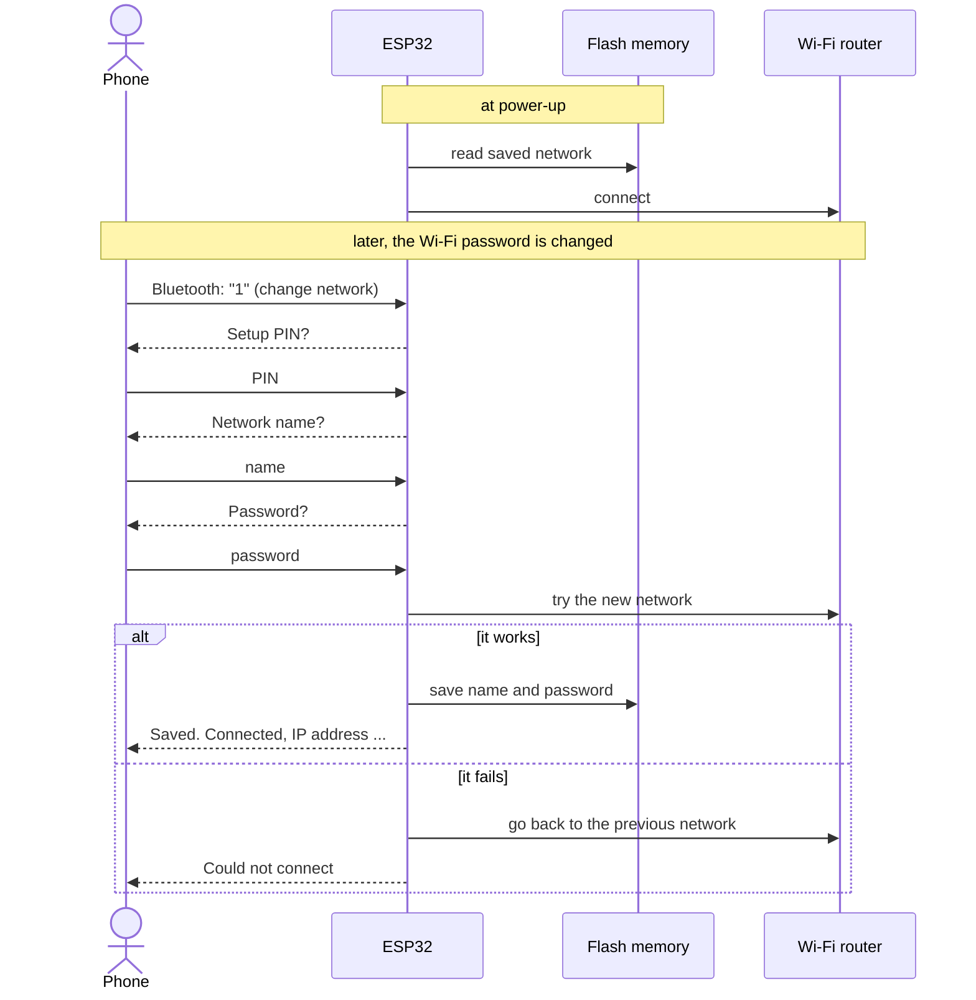
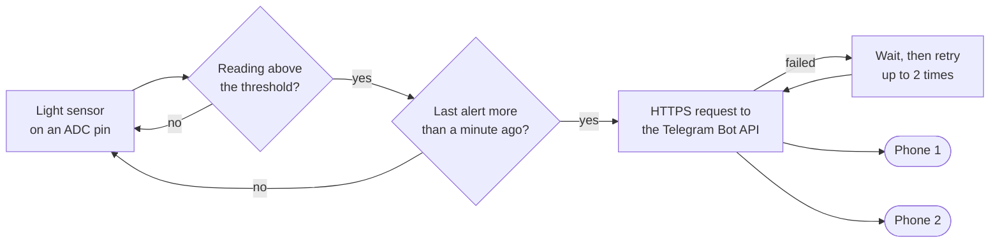
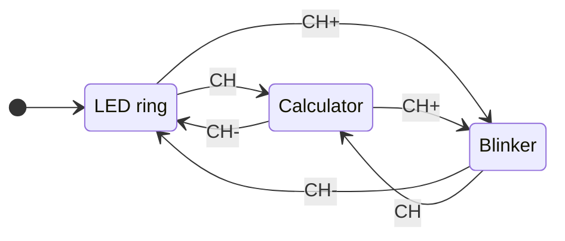

# ESP32 and Arduino experiments


A collection of small embedded projects and sensor experiments, each one a self-contained
sketch with its wiring written at the top of the file. They are listed here from the most
interesting to the most basic.

| | Project | Board | What it shows |
|---|---|---|---|
| 1 | [Wi-Fi provisioning over Bluetooth](#1-wi-fi-provisioning-over-bluetooth) | ESP32 | Changing the Wi-Fi network from a phone, without reflashing |
| 2 | [Telegram alerts](#2-telegram-alerts) | ESP32 | Phone notifications from a sensor, to several people, with a picture |
| 3 | [IR remote multi-tool](#3-ir-remote-multi-tool) | Arduino UNO | Three applications driven by one infrared remote |
| 4 | [Fingerprint sensor](#4-fingerprint-sensor) | ESP32 | Enrolling and recognising fingerprints |
| 5 | [Building blocks](#5-building-blocks) | ESP32 | Button, relay, motion, distance, keypad, LCD |

## 1. Wi-Fi provisioning over Bluetooth

[`esp32/wifi_provisioning_bluetooth`](esp32/wifi_provisioning_bluetooth/wifi_provisioning_bluetooth.ino)

**The problem.** A connected device usually has the name and password of the Wi-Fi network
written in its code. The day the router is replaced or its password changes, the device is
offline, and the only way back is to plug it into a computer and flash it again. That is not
acceptable for something installed in a house.

**The solution.** The ESP32 has two radios. While Wi-Fi is down, Bluetooth still works, so it is
used as a second door: the user connects with a phone, types the new network name and password,
and the board reconnects by itself.



What makes it dependable:

- **Credentials are stored in flash** (NVS, through `Preferences`), so they survive resets and
  power cuts. Nothing is hard-coded.
- **New credentials are tested before they are saved.** A typing mistake does not replace a
  working configuration: the board goes back to the previous network.
- **A setup PIN** is asked before the settings can be changed, since anyone nearby can see the
  Bluetooth device.
- **The dialogue is a small state machine** (idle, waiting for the PIN, for the name, for the
  password), so each line received is interpreted according to the question asked.
- The Wi-Fi password is never printed on the USB serial log.

Once connected, the board serves a web page with ON and OFF buttons that drive GPIO 2, which
shows that it is reachable at its new address.

**Try it.** Flash the sketch, pair the phone with `ESP32_BT_Config`, open a serial Bluetooth
terminal app and send `1`. The default PIN is `1234`; change `SETUP_PIN` in the sketch. Send `2`
at any time to see the connection and the IP address.

> Classic Bluetooth exists on the original ESP32 (WROOM, DevKit v1), not on the S2, S3 and C3
> variants. With Wi-Fi and Bluetooth together the program is large: if the IDE says the sketch is
> too big, choose *Tools > Partition Scheme > Huge APP*.

## 2. Telegram alerts

[`esp32/telegram_alerts`](esp32/telegram_alerts)

A sensor that nobody looks at is of little use. Here the ESP32 sends a **Telegram message** when a
reading crosses a threshold, so the alert arrives as an ordinary notification on a phone, anywhere
in the world. There is no mobile app to develop and no server to host: the board calls the
Telegram Bot API itself, over HTTPS, with the certificate of the server verified.



The three sketches build on each other:

| Sketch | Adds |
|---|---|
| [`telegram_alert_basic`](esp32/telegram_alerts/telegram_alert_basic/telegram_alert_basic.ino) | One message to one chat when the light level goes above the threshold |
| [`telegram_alert_multi_recipient`](esp32/telegram_alerts/telegram_alert_multi_recipient/telegram_alert_multi_recipient.ino) | A list of recipients, retries with a growing delay when a message fails, a start-up message with the network name and IP address, Wi-Fi reconnection |
| [`telegram_alert_photo`](esp32/telegram_alerts/telegram_alert_photo/telegram_alert_photo.ino) | A picture with a caption after each alert, sent as a link that Telegram downloads itself |

A light sensor is used as the trigger because it is easy to test with a hand or a lamp. Any other
sensor of this repository can take its place: a motion sensor, a distance below a limit, an
unknown fingerprint.

Details worth noting:

- **A cooldown** limits the alerts to one per minute, so a reading that stays high does not flood
  the chat. It is measured with `millis()`, without blocking the loop.
- **The sensor is on GPIO 34**, an ADC1 pin: the ADC2 pins of the ESP32 cannot be read while
  Wi-Fi is in use.
- **No secret in the code.** The Wi-Fi password and the bot token live in a `secrets.h` file that
  git ignores.

**Try it.**

1. In Telegram, create a bot with [@BotFather](https://t.me/BotFather) and copy its token.
2. Get your chat id from [@myidbot](https://t.me/myidbot), then send `/start` to your new bot.
3. In the folder of the sketch, copy `secrets.example.h` to `secrets.h` and fill it in.
4. Install the libraries *UniversalTelegramBot* and *ArduinoJson*, then flash.

## 3. IR remote multi-tool

[`arduino_uno/ir_remote_multitool`](arduino_uno/ir_remote_multitool/ir_remote_multitool.ino) · made with Naim Ayroud

One infrared remote control, three applications. The top row of the remote chooses the
application, and the same keys then mean different things in each one.



| Application | Keys | Behaviour |
|---|---|---|
| **LED ring** (`CH-`) | `PLAY`, `NEXT`, `PREV`, `1` to `4` | One of four LEDs is lit. `NEXT` and `PREV` move the light around the ring, the digits jump to a LED, `PLAY` switches the ring on and off |
| **Calculator** (`CH`) | digits, `VOL+`, `VOL-`, `EQ` | Whole numbers are typed on the remote; `VOL+` adds, `VOL-` subtracts, `EQ` prints the result on the Serial Monitor. Operations can be chained: `10 + 5 - 3 = 12` |
| **Blinker** (`CH+`) | `VOL+`, `VOL-` | An LED blinks; the keys change the blink delay from 0 (always on) to 800 ms in steps of 100 ms |

How it is written:

- **Key codes are named constants** and the ten digit keys are a lookup table, so the logic reads
  as `KEY_NEXT` and `digitOf(code)` instead of hexadecimal numbers.
- **Each application has its own handler**, and one dispatcher sends a key to the handler of the
  active application.
- **Held keys are ignored.** A remote repeats its signal while a key is held down; repeat frames
  are filtered out so that one press is one action.
- **The blinker does not use `delay()`.** It compares `millis()` with the time of the last toggle,
  so the remote stays responsive while the LED blinks.
- **The calculator uses `long`**, because an `int` is 16 bits on the UNO and would overflow above
  32767. Input is limited to 9 digits.

**Wiring.** IR receiver (VS1838B) output on D3; ring LEDs on D8 to D11 and blink LED on D12, each
through a 220 Ω resistor. Library: *IRremote*. The codes are those of the common 21-key NEC
remote; for another remote, print the code of each key and replace the `KEY_` constants.

## 4. Fingerprint sensor

[`esp32/fingerprint`](esp32/fingerprint)

Three sketches for the AS608 / R307 optical fingerprint module, in the order they are used. The
sensor is connected to the second hardware UART of the ESP32 (GPIO 16 and 17), which leaves the
USB serial port free for messages.

| Step | Sketch | Purpose |
|---|---|---|
| 1 | [`fingerprint_sensor_check`](esp32/fingerprint/fingerprint_sensor_check/fingerprint_sensor_check.ino) | Checks that the sensor answers, to validate the wiring |
| 2 | [`fingerprint_enroll`](esp32/fingerprint/fingerprint_enroll/fingerprint_enroll.ino) | Scans a finger twice and stores it in the sensor under an ID from 1 to 127 |
| 3 | [`fingerprint_identify`](esp32/fingerprint/fingerprint_identify/fingerprint_identify.ino) | Recognises enrolled fingers and prints the ID and the confidence of the match |

The prints are stored inside the sensor, not in the ESP32, so they remain when the board is
reprogrammed. Steps 2 and 3 are adapted to the ESP32 from the examples of the
[Adafruit Fingerprint Sensor Library](https://github.com/adafruit/Adafruit-Fingerprint-Sensor-Library).

## 5. Building blocks

[`esp32/basics`](esp32/basics)

Short sketches, one per component, written to learn each part before combining them.

| Sketch | Component | What it does | Pins |
|---|---|---|---|
| [`push_button`](esp32/basics/push_button/push_button.ino) | Push button | Reports each press once, using the internal pull-up resistor | 13 |
| [`relay_serial_control`](esp32/basics/relay_serial_control/relay_serial_control.ino) | Relay module | Switches an active-low relay with `on` and `off` typed in the Serial Monitor | 26 |
| [`pir_motion`](esp32/basics/pir_motion/pir_motion.ino) | HC-SR501 PIR | Lights an LED while there is movement and reports when it starts and stops | 2, 4 |
| [`ultrasonic_distance`](esp32/basics/ultrasonic_distance/ultrasonic_distance.ino) | HC-SR04 | Measures a distance from the travel time of an ultrasound pulse | 5, 18 |
| [`keypad_4x3`](esp32/basics/keypad_4x3/keypad_4x3.ino) | 4x3 keypad | Reads 12 keys with 7 pins by scanning rows and columns | 32, 33, 25, 26, 27, 14, 12 |
| [`lcd_i2c_text`](esp32/basics/lcd_i2c_text/lcd_i2c_text.ino) | 16x2 LCD (I2C) | Displays fixed text on both rows | 21, 22 |
| [`lcd_i2c_typewriter`](esp32/basics/lcd_i2c_typewriter/lcd_i2c_typewriter.ino) | 16x2 LCD (I2C) | Displays text one character at a time | 21, 22 |

## Running a sketch

1. Install the [Arduino IDE](https://www.arduino.cc/en/software). For the ESP32 sketches, add
   the *esp32* boards package by Espressif (Boards Manager) and select *ESP32 Dev Module*; for the
   IR project select *Arduino UNO*.
2. Open the `.ino` file. Each sketch is in a folder of the same name, as the IDE requires.
3. Install the libraries named at the top of the sketch (Library Manager).
4. Wire the components as described at the top of the sketch, then upload.

| Library | Used by |
|---|---|
| UniversalTelegramBot, ArduinoJson | Telegram alerts |
| IRremote | IR remote multi-tool |
| Adafruit Fingerprint Sensor Library | Fingerprint sensor |
| Keypad | `keypad_4x3` |
| LiquidCrystal I2C | LCD sketches |

`BluetoothSerial`, `Preferences`, `WebServer` and `WiFi` come with the ESP32 boards package.

## Repository layout

```
esp32-arduino-experiments/
├── esp32/
│   ├── wifi_provisioning_bluetooth/
│   ├── telegram_alerts/
│   │   ├── telegram_alert_basic/            # each with a secrets.example.h
│   │   ├── telegram_alert_multi_recipient/
│   │   └── telegram_alert_photo/
│   ├── fingerprint/
│   │   ├── fingerprint_sensor_check/
│   │   ├── fingerprint_enroll/
│   │   └── fingerprint_identify/
│   └── basics/
│       ├── push_button/
│       ├── relay_serial_control/
│       ├── pir_motion/
│       ├── ultrasonic_distance/
│       ├── keypad_4x3/
│       ├── lcd_i2c_text/
│       └── lcd_i2c_typewriter/
├── arduino_uno/
│   └── ir_remote_multitool/
├── LICENSE
└── README.md
```

## License

Released under the [MIT License](LICENSE). The fingerprint sketches are adapted from the examples
of the Adafruit Fingerprint Sensor Library (BSD license).
